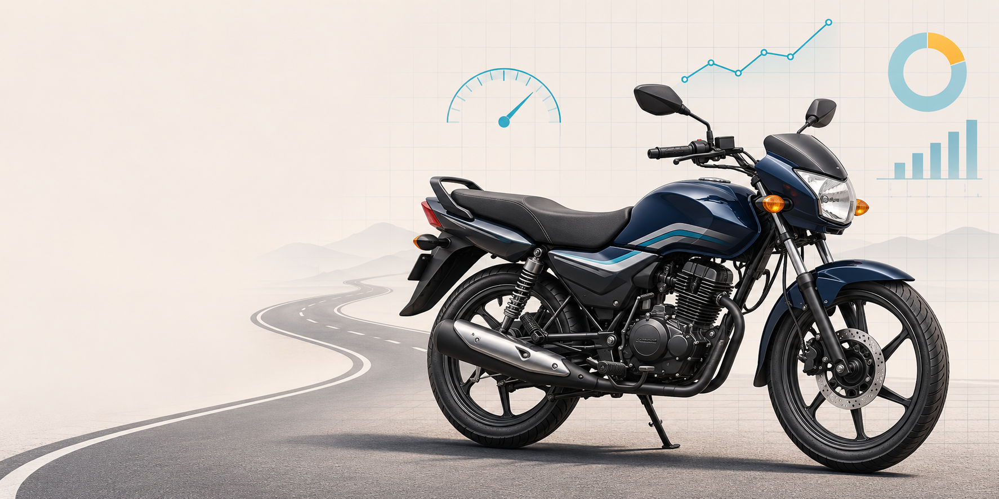
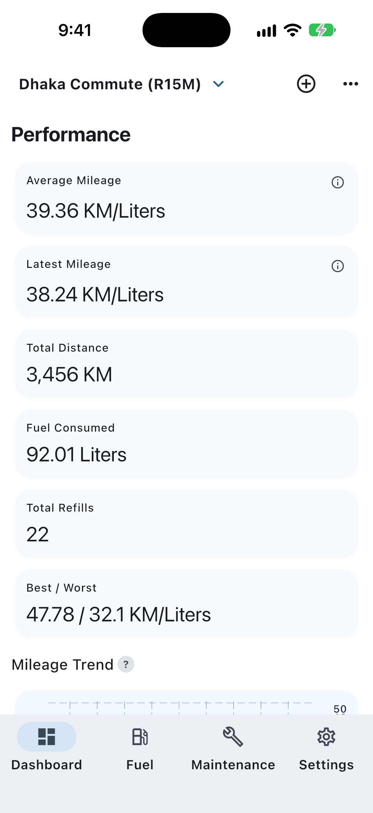

# Moto Mileage

<div align="center">
  

  <p><strong>A private, offline-first logbook for motorcycle fuel, mileage, costs, and maintenance.</strong></p>
</div>

Moto Mileage helps riders keep a clear record of each bike’s running costs and service history. Add a bike, log refills and odometer readings, and use the automatically calculated mileage and expense summaries to understand how it is performing. All records stay on the device; the app does not require an account or cloud service.

## App screenshots

| Dashboard | Maintenance log |
| --- | --- |
|  |  |

The dashboard image was captured from a debug build in the iPhone 18 Pro simulator. The maintenance image is from the project’s iPhone 17 Pro promotional captures.

## Features

- **Multiple bikes:** Store separate fuel and maintenance histories for each bike. Set the distance and fuel units for each bike.
- **Fuel log:** Record the date, odometer, quantity, total cost, fuel type, station, and notes for each refill.
- **Mileage and cost calculations:** Calculate trip distance, fuel economy, fuel price per unit, and cost per distance from refill data.
- **Dashboard analytics:** Review average and latest mileage, total distance, fuel consumed, refill count, spending, and mileage and expense trends.
- **Fuel station report:** Compare refill activity and costs by station.
- **Maintenance history:** Log services such as oil changes, chain lubrication, brakes, tires, and custom work. Set an odometer target for the next service and see due or overdue entries.
- **Refill reminders:** Set a preferred distance interval between refills.
- **CSV export and JSON backup:** Export fuel records to CSV, or back up bikes, settings, fuel logs, and maintenance records to JSON for sharing or later restore.
- **Demo data and tips:** Populate sample bikes and records to explore the app, and browse motorcycle care tips.
- **Personalization:** Choose from 14 theme presets, set currency and decimal precision, and use English, Simplified Chinese, Hindi, Spanish, French, Bengali, Portuguese, Russian, or Indonesian.

## Calculation behavior

Fuel entries are sorted by date and odometer, then recalculated as a chronological chain whenever an entry is added, edited, or deleted. The first entry is the odometer baseline and has no trip distance or mileage. For later entries, a positive odometer difference is required for a valid trip. Mileage is trip distance divided by the current entry’s fuel quantity; price per unit is total cost divided by a positive quantity; cost per distance is calculated only for a valid trip.

Maintenance due status is based on the active bike’s current odometer and an entry’s next-due odometer. Fuel and maintenance records are scoped to a bike ID, so switching bikes changes the history being shown.

## Privacy and storage

The app is designed to work offline. SQLite stores values in a local key-value table, with most domain records serialized as JSON. There is no sign-in, backend, or cloud synchronization. CSV export and JSON backup use the device’s file and sharing flows and are initiated by the user.

## Tech stack

- Flutter with Dart SDK `^3.10.7` and Material 3
- GetX for state management, navigation, and dependency injection
- `sqflite` for local persistence, with `path` and `path_provider` for file paths
- `fl_chart` and `flutter_staggered_grid_view` for dashboard charts and layouts
- `intl` for date formatting, `uuid` for record IDs, and `share_plus` for exports

## Project structure

```text
lib/
  main.dart                 App entry point and startup initialization
  app/
    bindings/               Dependency registration
    constants.dart          Storage keys and domain enums
    controllers/            Reactive state and business rules
    data/                   Built-in motorcycle care tips
    localization/           Supported locales and translations
    models/                 Serializable bike, fuel, and maintenance data
    repositories/           Persistence access for domain records
    services/               Storage, backup, export, and demo data
    theme/                  Theme presets and Material theme wiring
    views/                  Screens, sheets, and reusable widgets
    utils/                  Formatting and asset helpers
assets/
  readme/                   README cover and dashboard screenshot
  MotoMileage - Promotional Images/  Store and product screenshots
test/                        Flutter tests
```

Views call controllers, controllers coordinate workflows and calculations, repositories read and write records through `LocalStorageService`, and models remain serializable. Register new services, repositories, and controllers in `InitialBinding`. When adding persistent user data, update backup and restore behavior as well as the related model and repository.

## Getting started

### Requirements

- Flutter stable with Dart SDK `^3.10.7`
- Xcode and an iOS Simulator for iOS development
- Android Studio or an Android SDK for Android development

### Run locally

```sh
git clone https://github.com/WorkWithAfridi/MotoMileage.git
cd MotoMileage
flutter pub get
flutter run
```

To select a simulator or device explicitly:

```sh
flutter devices
flutter run -d <device-id>
```

### Build

```sh
flutter build apk
flutter build appbundle
flutter build ios
```

## Development checks

```sh
dart format lib test
flutter analyze
flutter test
```

When changing fuel calculations, persistence, backup and restore, or bike deletion behavior, update targeted tests. For interface changes, review the affected flow on a simulator or device.

## License

Moto Mileage is licensed under the [MIT License](LICENSE).
